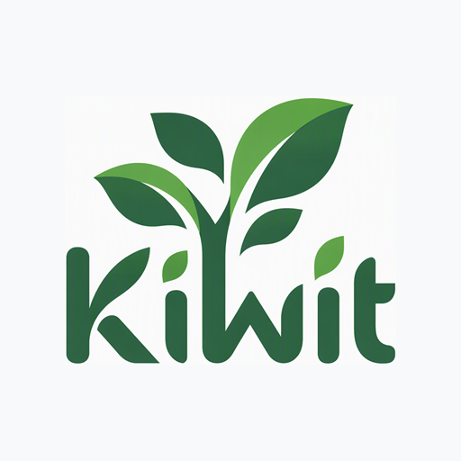
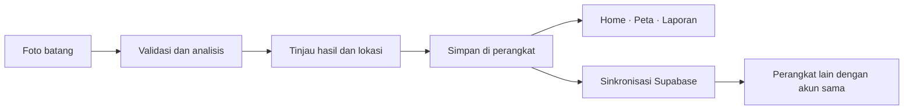

<div align="center">



# KiWit

### Rawat pohon kota, mulai dari satu inspeksi.

Aplikasi pendamping inspeksi pohon untuk petugas lapangan.<br />
Ambil foto, catat kondisi, dan pantau hasilnya melalui peta serta laporan.


[Tentang](#tentang-kiwit) · [Fitur](#fitur-utama) · [Mulai](#menjalankan-project) · [Tim](#tim-pengembang) · [Dokumentasi](#dokumentasi)

</div>

---

## Tentang KiWit

KiWit membantu petugas mencatat inspeksi pohon secara terstruktur, dari pengambilan foto di lapangan sampai peninjauan riwayat. Dirancang untuk konteks inspeksi pohon perkotaan di Surabaya, aplikasi ini menghubungkan hasil scan, lokasi, catatan petugas, dan status sinkronisasi dalam satu alur.

Hasil inspeksi disimpan di perangkat terlebih dahulu. Saat koneksi tersedia, data dan foto disinkronkan ke Supabase agar dapat diakses dari perangkat lain dengan akun yang sama.

> **Tahap pengembangan:** prototipe untuk demo dan evaluasi lapangan. Analisis otomatis membantu pencatatan awal; hasilnya tetap perlu ditinjau oleh petugas.

## Fitur utama

| Fitur | Yang bisa dilakukan |
| :--- | :--- |
| **Akun petugas** | Daftar, masuk, pulihkan kata sandi, dan kelola profil serta rayon penugasan. |
| **Inspeksi kamera** | Ambil foto kulit batang dan proses segmentasi dengan YOLO11 melalui ONNX Runtime. Foto dengan bukti deteksi yang tidak memadai diminta diulang. |
| **Lokasi otomatis** | Cari GPS saat inspeksi; koreksi alamat atau titik peta setelah foto jika diperlukan. |
| **Home** | Lihat ringkasan, tren tujuh hari, dan inspeksi terbaru dari data tersimpan. |
| **Peta inspeksi** | Mulai dari posisi perangkat, telusuri inspeksi, dan filter menurut risiko atau rayon. Tersedia tampilan standar, satelit, dan topografi. |
| **Laporan** | Pilih bulan berjalan, bulan/tahun tertentu, satu tahun penuh, atau semua waktu. Saring daftar menurut risiko, kata kunci, dan status sinkronisasi. |
| **Detail inspeksi** | Baca foto, kondisi, risiko, lokasi, identitas petugas, dan catatan. |
| **Notifikasi aplikasi** | Tinjau pemberitahuan risiko tinggi/kritis dan masalah sinkronisasi dari lonceng Home. |
| **Penyimpanan & sinkronisasi** | Simpan hasil lokal sebelum unggah, coba kembali unggahan tertunda, dan terima pembaruan Supabase Realtime. |

### Dari lapangan ke laporan



Inspeksi tanpa koordinat valid tetap tersimpan dalam daftar, tetapi belum ditampilkan sebagai titik pada peta.

## Teknologi

| Bagian | Teknologi |
| :--- | :--- |
| Aplikasi | Flutter, Dart, Material 3, Plus Jakarta Sans |
| State | Riverpod |
| Backend | Supabase Auth, PostgreSQL, Storage privat, Realtime |
| Analisis foto | YOLO11 segmentation, ONNX Runtime, pemrosesan gambar di isolate |
| Peta & GPS | Flutter Map, Geolocator, OpenStreetMap, Esri, OpenTopoMap |
| Perangkat | Camera, Permission Handler |
| Grafik | FL Chart |

## Menjalankan project

### Prasyarat

- Flutter dengan Dart **`>=3.12.2 <4.0.0`**, sesuai `pubspec.yaml`.
- Android SDK yang mendukung **compile SDK 37** dan JDK **17**.
- Perangkat Android **7.0 / API 24** atau lebih baru. Gunakan HP fisik untuk memeriksa kamera, GPS, dan inferensi model.
- Project Supabase untuk autentikasi dan sinkronisasi.

### 1. Ambil source code

```bash
git clone https://github.com/ahmadsyahani/KiWit-App.git
cd KiWit-App
flutter pub get
```

### 2. Siapkan konfigurasi

Salin `.env.example` menjadi `.env`. Pada PowerShell:

```powershell
Copy-Item .env.example .env
```

Isi konfigurasi Supabase:

```dotenv
SUPABASE_URL=https://your-project-id.supabase.co
SUPABASE_ANON_KEY=your-anon-key-here
```

Gunakan key klien Supabase, bukan `service_role` atau secret key server. File `.env` diabaikan oleh Git. Karena didaftarkan sebagai aset Flutter, file ini tetap harus tersedia saat aplikasi dibuild.

### 3. Siapkan Supabase

1. Aktifkan autentikasi email/password pada project Supabase.
2. Buka **SQL Editor** dan jalankan [migration inspeksi](supabase/migrations/202610170001_inspections.sql).
3. Migration menyiapkan tabel `inspections`, kebijakan akses per akun, bucket foto privat `kiwit-inspection-photos`, dan publication Realtime.
4. Sesuaikan konfirmasi email dan URL pemulihan kata sandi dengan lingkungan pengujian.

Profil dapat memakai metadata akun Auth. Tabel `profiles`, jika tersedia pada backend, dipakai untuk sinkronisasi profil; migration inspeksi tidak membuat tabel tersebut.

Panduan lengkap: [setup dan sinkronisasi inspeksi](docs/inspection-sync.md).

### 4. Jalankan di perangkat

```bash
flutter devices
flutter run --no-enable-impeller
```

Izinkan kamera dan lokasi saat diminta. Pada terminal Flutter, tekan `r` untuk hot reload dan `R` untuk hot restart. Perubahan ikon, nama aplikasi, atau konfigurasi Android memerlukan build dan instalasi ulang.

## Membuat APK

Pada Windows, script berikut membuat build release dan menyalin hasilnya menjadi **`KiWit.apk`**:

```powershell
.\tool\build_kiwit_apk.ps1
```

Jika eksekusi script dibatasi PowerShell, jalankan khusus untuk proses tersebut:

```powershell
powershell -NoProfile -ExecutionPolicy Bypass -File .\tool\build_kiwit_apk.ps1
```

Hasil:

```text
build/app/outputs/flutter-apk/KiWit.apk
```

Alternatif build Flutter biasa:

```bash
flutter build apk --release
```

Perintah biasa menghasilkan `app-release.apk`. Konfigurasi release saat ini masih memakai debug signing; siapkan keystore release sebelum distribusi produksi. Keberhasilan build release dan perilaku APK tetap perlu diperiksa di perangkat tujuan.

## Struktur project

```text
lib/
├── core/                 # Tema, konfigurasi, layanan, dan komponen bersama
└── features/
    ├── auth/             # Login, register, dan pemulihan akun
    ├── home/             # Ringkasan dan tren inspeksi
    ├── map/              # Titik inspeksi, pencarian, dan lokasi perangkat
    ├── notifications/    # Kotak notifikasi dalam aplikasi
    ├── profile/          # Profil petugas
    ├── report/           # Filter periode dan daftar laporan
    └── scan/             # Kamera, analisis, penyimpanan, dan sinkronisasi
assets/
├── branding/             # Logo KiWit
└── models/               # Model ONNX
supabase/migrations/      # Skema dan kebijakan data inspeksi
test/                     # Test logika dan widget
tool/                     # Generator ikon dan script build APK
docs/                     # Catatan alur dan batas implementasi
```

## Pemeriksaan

```bash
flutter analyze --no-pub
flutter test --no-pub
```

Test mencakup alur kamera dan lokasi, validasi output model, sinkronisasi, isolasi akun, peta, laporan, notifikasi, detail inspeksi, dan tampilan auth. Sebagian pemeriksaan memakai adapter atau data simulasi; kelulusannya belum membuktikan akurasi model atau keberhasilan sensor pada perangkat fisik.

### Batas prototipe

- Model berfokus pada **kulit batang**, bukan semua jenis tanaman atau identifikasi spesies. Benda dengan tekstur mirip batang masih dapat salah dikenali.
- Diameter dan kemiringan otomatis masih **estimasi yang belum terkalibrasi**. Indikasi penyakit serta kategori risiko memerlukan peninjauan lapangan.
- Sinkronisasi berlaku untuk **akun yang sama**. Dashboard lintas petugas/rayon belum tersedia.
- Notifikasi berada **di dalam aplikasi**; status baca disimpan lokal per akun/perangkat. Push notification sistem belum tersedia.
- Tampilan dasar peta dan penerjemahan koordinat menjadi alamat memerlukan koneksi. Penyimpanan inspeksi lokal tetap tersedia saat koneksi terputus.

## Tim pengembang

| Anggota | GitHub |
| :--- | :--- |
| **Ahmad Syahani** | [@ahmadsyahani](https://github.com/ahmadsyahani) |
| **Lugas Madya Hanestyan** | [@garyeggsy](https://github.com/garyeggsy) |
| **Daffa Rahman Budi Santoso** | [@damanbs](https://github.com/damanbs) |

## Dokumentasi

| Panduan | Isi |
| :--- | :--- |
| [Kamera dan scan](docs/scan-flow.md) | Pengambilan foto, validasi objek, dan batas model. |
| [Penyimpanan dan sinkronisasi](docs/inspection-sync.md) | Setup Supabase, penyimpanan lokal, dan akses antarperangkat. |
| [Peta inspeksi](docs/map-data-flow.md) | Lokasi perangkat, marker, filter, dan inspeksi tanpa koordinat. |
| [Laporan](docs/report-data-flow.md) | Periode bulan/tahun, ringkasan, dan pencarian. |
| [Notifikasi](docs/notifications.md) | Pemberitahuan risiko dan antrean sinkronisasi. |
| [Identitas Android](docs/android-branding.md) | Logo, ikon launcher, nama aplikasi, dan build APK. |

---

<div align="center">

**KiWit**<br />
Catat kondisinya. Kenali risikonya. Rawat pohonnya.

</div>
